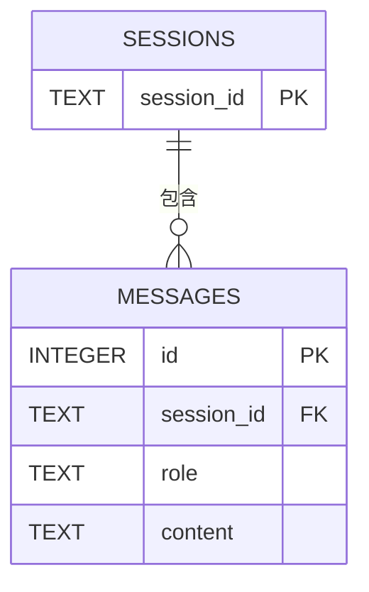

## 数据库设计 (ER 图)



# 聊天机器人 FastAPI 服务

基于上次作业改造成 FastAPI 服务，支持连续对话、流式输出和英语纠错功能。

## 启动方法

1. 安装依赖：`pip install -r requirements.txt`
2. 启动服务：`uvicorn app.main:app --reload`

启动后访问 `http://127.0.0.1:8000/docs` 查看 Swagger 接口文档，访问 `http://127.0.0.1:8000/` 使用网页聊天界面。

## 主要接口请求示例

### 1. 普通对话
**POST** `/chat`
```json
{
  "session_id": "u1",
  "message": "你好"
}
```
