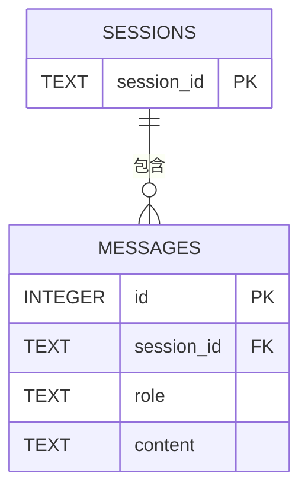

# 聊天机器人（FastAPI + Vue 3）

前后端分离的聊天机器人项目：`backend/` 是 FastAPI + SQLite（SQLAlchemy 2.x ORM）后端服务，`frontend/` 是 Vue 3 + Vite 前端空工程。

## 项目结构

```
chatbot/
├── backend/                 # 后端（FastAPI + SQLAlchemy）
│   ├── app/
│   │   ├── __init__.py
│   │   ├── main.py          # FastAPI 应用入口，挂载路由与 static 目录
│   │   ├── config.py        # pydantic-settings 配置（读取 .env）
│   │   ├── database.py      # Engine / Session / init_db
│   │   ├── models.py        # ORM 模型 SessionModel / MessageModel
│   │   ├── schemas.py       # 请求体模型 ChatRequest / StudyRequest
│   │   ├── storage.py       # 存储层：事务写入、关键词查询
│   │   └── routers/
│   │       ├── __init__.py
│   │       └── chat.py      # /chat、/chat/stream、/sessions、/study/correct
│   ├── static/
│   │   └── index.html       # 极简网页聊天界面，由 FastAPI 托管
│   ├── tests/               # pytest 用例（17 个，含 ORM / 事务 / 关键词查询）
│   ├── pytest.ini           # testpaths=tests，pythonpath=.（可直接在 backend 下跑 pytest）
│   ├── requirements.txt     # 后端依赖
│   ├── .env.example         # 环境变量模板
│   ├── llm.py               # DeepSeek 客户端封装（流式输出）
│   ├── main.py              # 命令行版聊天入口
│   └── chat.db              # 本地 SQLite 数据库（被 .gitignore 忽略，不提交）
├── frontend/                # 前端（Vue 3 + Vite 空工程）
│   ├── src/                 # main.js、App.vue、components/HelloWorld.vue
│   ├── public/
│   ├── index.html
│   ├── vite.config.js
│   └── package.json
├── README.md
└── .gitignore
```

## 后端启动

```bash
cd backend
python -m pip install -r requirements.txt
python -m uvicorn app.main:app --reload
```

- 网页聊天界面：http://127.0.0.1:8000/
- Swagger 接口文档：http://127.0.0.1:8000/docs
- `chat.db` 在 `backend/` 目录下生成/读取，必须以 `backend/` 作为工作目录启动

### 后端测试

```bash
cd backend
python -m pytest
```

当前 17 passed。测试通过 `CHATBOT_DB_URL` 指向临时目录下的 SQLite 文件，不会读写本地 `chat.db`。

### 主要接口

| 方法 | 路径 | 说明 |
|---|---|---|
| POST | `/chat` | 普通对话，一次事务写入用户消息与回复 |
| POST | `/chat/stream` | 流式输出测试 |
| GET | `/sessions` | 列出所有会话 |
| GET | `/sessions/{session_id}/messages` | 取历史记录，支持 `?keyword=` 模糊查询 |
| DELETE | `/sessions/{session_id}` | 清空会话（级联删除消息） |
| POST | `/study/correct` | 英语句子纠错（模拟返回） |

## 前端启动

```bash
cd frontend
npm install
npm run dev
```

Vite 开发服务器默认地址：http://127.0.0.1:5173/；打包命令 `npm run build`，产物输出到 `frontend/dist/`（已被忽略）。

## 数据库设计 (ER 图)



### ORM 查询与原生 SQL 对照

数据访问层已从原生 `sqlite3` 换成 **SQLAlchemy 2.x ORM**，表名、字段名与旧库完全一致，原有数据可以直接读取。
`app/models.py` 中 `SessionModel`（`sessions` 表）与 `MessageModel`（`messages` 表）通过 `relationship` 建立一对多关联，
外键上的 `ondelete="CASCADE"` 保证删会话时消息一起清掉。

`app/storage.py` 里取历史记录的那段 ORM 查询：

```python
stmt = (
    select(MessageModel)
    .where(MessageModel.session_id == session_id)
    .order_by(MessageModel.id.asc())
)
rows = db.scalars(stmt).all()
```

它对应的原生 SQL 就是：

```sql
SELECT id, session_id, role, content
FROM messages
WHERE session_id = ?
ORDER BY id ASC;
```

按关键词搜索历史消息时，只是在同一条查询上追加一个 `LIKE` 条件：

```python
stmt = stmt.where(MessageModel.content.contains(keyword))
```

```sql
-- 等价 SQL：接口 GET /sessions/{session_id}/messages?keyword=xxx
SELECT id, session_id, role, content
FROM messages
WHERE session_id = ? AND content LIKE '%xxx%'
ORDER BY id ASC;
```

写入一轮对话时，`add_exchange()` 把「用户消息 + 助手回复」放在**同一个事务**里，对应三条语句：

```sql
INSERT OR IGNORE INTO sessions (session_id) VALUES (?);
INSERT INTO messages (session_id, role, content) VALUES (?, 'user', ?);
INSERT INTO messages (session_id, role, content) VALUES (?, 'assistant', ?);
-- 两条都成功才 COMMIT，任一条失败则 ROLLBACK，不会只留下半轮对话
```
