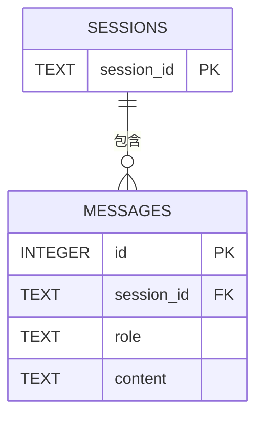

## 数据库设计 (ER 图)



### ORM 查询与原生 SQL 对照

数据访问层已从原生 `sqlite3` 换成 **SQLAlchemy 2.x ORM**，表名、字段名与旧库完全一致，原有数据可以直接读取。
`app/models.py` 中 `SessionModel`（`sessions` 表）与 `MessageModel`（`messages` 表）通过 `relationship` 建立一对多关联，
外键上的 `ondelete="CASCADE"` 保证删会话时消息一起清掉。

`app/storage.py` 里取历史记录的那段 ORM 查询：

```python
stmt = (
    select(MessageModel)
    .where(MessageModel.session_id == session_id)
    .order_by(MessageModel.id.asc())
)
rows = db.scalars(stmt).all()
```

它对应的原生 SQL 就是：

```sql
SELECT id, session_id, role, content
FROM messages
WHERE session_id = ?
ORDER BY id ASC;
```

写入一轮对话时，`add_exchange()` 把「用户消息 + 助手回复」放在**同一个事务**里，对应三条语句：

```sql
INSERT OR IGNORE INTO sessions (session_id) VALUES (?);
INSERT INTO messages (session_id, role, content) VALUES (?, 'user', ?);
INSERT INTO messages (session_id, role, content) VALUES (?, 'assistant', ?);
-- 两条都成功才 COMMIT，任一条失败则 ROLLBACK，不会只留下半轮对话
```

# 聊天机器人 FastAPI 服务

基于上次作业改造成 FastAPI 服务，支持连续对话、流式输出和英语纠错功能。

## 启动方法

1. 安装依赖：`pip install -r requirements.txt`
2. 启动服务：`uvicorn app.main:app --reload`

启动后访问 `http://127.0.0.1:8000/docs` 查看 Swagger 接口文档，访问 `http://127.0.0.1:8000/` 使用网页聊天界面。

## 主要接口请求示例

### 1. 普通对话
**POST** `/chat`
```json
{
  "session_id": "u1",
  "message": "你好"
}
```
